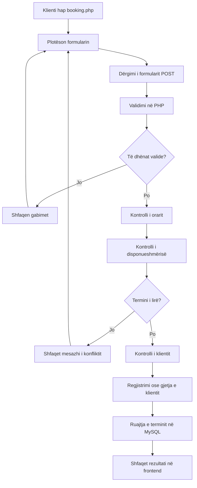

# RAPORTI TEKNIK 3
## Frontend-i, Integrimi dhe Progresi Funksional

**Projekti:** LUMIÈRE Beauty Studio – Sistemi për Menaxhimin e Salloneve të Bukurisë  

---

# 1. Hyrje

Raporti Teknik 3 paraqet fazën e zhvillimit të frontend-it dhe integrimit të tij me backend-in dhe databazën për projektin LUMIÈRE Beauty Studio.

Në këtë fazë fokusi kryesor është funksionalizimi i aplikacionit dhe realizimi i proceseve kryesore që mundësojnë komunikimin ndërmjet përdoruesit, ndërfaqes grafike, logjikës së aplikacionit dhe databazës.

Gjatë kësaj faze janë zhvilluar faqet publike të aplikacionit, është realizuar sistemi i rezervimit të termineve dhe është mundësuar integrimi i rezervimeve me panelin administrativ.

Gjithashtu, është implementuar funksionaliteti për shikimin dhe anulimin e rezervimeve nga ana e klientit, si dhe përditësimi i statusit të termineve nga administratori.

Qëllimi është që aplikacioni të funksionojë si një sistem i përdorshëm, ku të dhënat nuk paraqiten vetëm në ndërfaqe, por përpunohen dhe ruhen në databazë.

# 2. Frontend dhe organizimi i kodit

## 2.1. Organizimi i projektit

Projekti është organizuar në disa folderë kryesorë, ku secili ka përgjegjësi të caktuar. Kjo strukturë mundëson ndarjen e ndërfaqes së përdoruesit nga logjika e backend-it, komunikimi me databazën dhe dokumentacioni.

Struktura kryesore e projektit është:

```text
PROJEKT/
│
├── admin/
│   ├── index.php
│   ├── terminet.php
│   ├── klientet.php
│   ├── sherbimet.php
│   ├── stafi.php
│   ├── pagesat.php
│   ├── inventari.php
│   ├── shpenzimet.php
│   ├── raportet.php
│   └── ...
│
├── api/
│   └── clients.php
│
├── assets/
│   ├── css/
│   └── js/
│
├── config/
│   └── database.php
│
├── controllers/
│   └── ClientController.php
│
├── database/
│   └── schema.sql
│
├── docs/
│   ├── raporti-teknik-1.md
│   ├── raporti-teknik-2.md
│   └── raporti-teknik-3.md
│
├── frontend/
│   ├── assets/
│   │   ├── css/
│   │   ├── images/
│   │   └── js/
│   ├── includes/
│   │   ├── header.php
│   │   └── footer.php
│   ├── index.php
│   ├── about.php
│   ├── services.php
│   ├── team.php
│   ├── team-member.php
│   ├── gallery.php
│   ├── booking.php
│   ├── my-bookings.php
│   └── contact.php
│
├── includes/
│
├── models/
│   └── Client.php
│
├── repositories/
│   └── ClientRepository.php
│
├── services/
│   └── ClientService.php
│
└── views/
    └── clients/
        └── index.php
```

*Shënim: Struktura paraqet organizimin kryesor të identifikuar gjatë zhvillimit. Folderët përmbajnë edhe fajlla të tjerë që nuk janë paraqitur në këtë përmbledhje.*

## 2.2. Përshkrimi i folderëve

| Folderi | Përshkrimi |
|---|---|
| `admin/` | Përmban faqet e panelit administrativ për menaxhimin e sallonit. |
| `api/` | Përmban endpoint-et për komunikimin me backend-in. |
| `assets/` | Përmban resurset si CSS dhe JavaScript. |
| `config/` | Përmban konfigurimin dhe lidhjen me databazën. |
| `controllers/` | Përmban kontrolluesit që ndërmjetësojnë kërkesat dhe logjikën e aplikacionit. |
| `database/` | Përmban skemën SQL të databazës. |
| `docs/` | Përmban dokumentacionin dhe raportet teknike. |
| `frontend/` | Përmban faqet publike të aplikacionit. |
| `models/` | Përmban modelet e të dhënave. |
| `repositories/` | Përmban komponentët për qasje në të dhëna. |
| `services/` | Përmban logjikën e shërbimeve të aplikacionit. |
| `views/` | Përmban pamjet për paraqitjen e të dhënave. |

## 2.3. Organizimi i frontend-it

Frontend-i është ndërtuar duke përdorur PHP, HTML, CSS dhe JavaScript.

Faqet publike janë të ndara sipas funksionalitetit:

- **index.php** – faqja kryesore e aplikacionit.
- **about.php** – paraqet informacione rreth sallonit.
- **services.php** – paraqet shërbimet që ofron salloni.
- **team.php** – paraqet stafin.
- **team-member.php** – paraqet informacione për punonjësit.
- **gallery.php** – paraqet galerinë.
- **booking.php** – mundëson rezervimin e termineve.
- **my-bookings.php** – mundëson kërkimin dhe menaxhimin e rezervimeve nga klientët.
- **contact.php** – paraqet informacionet e kontaktit.

Për të shmangur përsëritjen e elementeve të përbashkëta, janë përdorur fajllat `header.php` dhe `footer.php`, të cilët përfshihen në faqet publike.

Stilet vizuale janë organizuar në fajlla të veçantë CSS, ndërsa funksionalitetet JavaScript janë ndarë sipas nevojave të faqeve.

## 2.4. Dizajni dhe përvoja e përdoruesit

Ndërfaqja e LUMIÈRE Beauty Studio është zhvilluar me një stil elegant dhe modern, duke përdorur një kombinim të ngjyrave krem, bezhë, kafe dhe nuanca të buta.

Vëmendje i është kushtuar:

- Navigimit të qartë ndërmjet faqeve.
- Organizimit të përmbajtjes.
- Paraqitjes së shërbimeve dhe stafit.
- Formularëve të kuptueshëm.
- Përshtatjes së ndërfaqes për madhësi të ndryshme të ekranit.

# 3. Integrimi Frontend – Backend – Database

## 3.1. Përshkrimi i integrimit

Integrimi ndërmjet frontend-it dhe backend-it është realizuar duke përdorur PHP dhe databazën MySQL.

Kur përdoruesi kryen një veprim në ndërfaqe, të dhënat dërgohen përmes formularëve HTTP POST. Backend-i në PHP i pranon këto të dhëna, kryen validimin dhe përpunimin e tyre dhe komunikon me databazën përmes PDO.

Databaza ruan informacionet e klientëve, shërbimeve, stafit dhe termineve.

Pas përfundimit të procesit, përdoruesit i paraqitet rezultati në ndërfaqe përmes mesazheve të suksesit ose gabimeve.

## 3.2. Lidhja me databazën

Lidhja me databazën menaxhohet përmes fajllit:

`config/database.php`

Për komunikimin me MySQL përdoret PDO (PHP Data Objects).

PDO mundëson ekzekutimin e query-ve SQL përmes prepared statements, të cilat ndihmojnë në mbrojtjen e aplikacionit nga SQL Injection.

## 3.3. Tabelat kryesore të përdorura

Gjatë integrimit të rezervimeve janë përdorur kryesisht tabelat:

| Tabela | Roli |
|---|---|
| `klientet` | Ruajtja e të dhënave të klientëve. |
| `sherbimet` | Ruajtja e shërbimeve dhe çmimeve. |
| `stafi` | Ruajtja e të dhënave të punonjësve. |
| `terminet` | Ruajtja e rezervimeve të klientëve. |

Tabela `terminet` lidhet me tabelat `klientet`, `sherbimet` dhe `stafi` përmes çelësave të huaj.

Kjo mundëson që çdo rezervim të lidhet me klientin, shërbimin dhe punonjësin përkatës.

# 4. Demonstrimi i flow-ve kryesore funksionale

Në këtë fazë janë realizuar dhe testuar disa procese kryesore që demonstrojnë funksionimin e aplikacionit nga ndërfaqja deri te databaza.

## 4.1. Flow 1 – Krijimi i rezervimit nga klienti

Një nga funksionalitetet kryesore të sistemit është rezervimi i termineve përmes faqes publike `booking.php`.

Procesi zhvillohet në këta hapa:

1. Klienti hap faqen e rezervimit.
2. Zgjedh shërbimin dhe punonjësin.
3. Zgjedh datën dhe orën e dëshiruar.
4. Plotëson të dhënat personale.
5. Formulari dërgon të dhënat përmes metodës POST.
6. Backend-i në PHP kryen validimin e të dhënave.
7. Kontrollohet orari i punës dhe disponueshmëria e punonjësit.
8. Sistemi kontrollon nëse klienti ekziston në databazë.
9. Nëse klienti nuk ekziston, regjistrohet si klient i ri.
10. Rezervimi ruhet në tabelën `terminet`.
11. Përdoruesi merr mesazhin për rezultatin e rezervimit.

### Diagrami i flow-it



### Validimi i formularit

Validimi realizohet në backend përmes PHP-së.

Kontrollohen të dhënat e kërkuara nga formulari, formati i tyre, data, ora dhe informacionet e klientit.

Gjithashtu, kontrollohet që termini të jetë brenda orarit të punës, i cili është nga ora 09:00 deri në 17:00.

### Kontrollimi i disponueshmërisë

Para regjistrimit të terminit, sistemi kontrollon nëse punonjësi ka një rezervim tjetër në të njëjtën periudhë kohore.

Ky kontroll merr parasysh edhe kohëzgjatjen e shërbimit, në mënyrë që të shmangen mbivendosjet ndërmjet termineve.

### Ruajtja në databazë

Pas validimit dhe kontrollimit të disponueshmërisë, sistemi identifikon klientin përmes të dhënave të tij.

Nëse klienti ekziston, përdoren të dhënat ekzistuese. Në të kundërtën, krijohet një regjistrim i ri në tabelën `klientet`.

Në fund, krijohet rezervimi i ri në tabelën `terminet` me status fillestar `Ne pritje`.

## 4.2. Flow 2 – Menaxhimi i rezervimeve nga administratori

Administratori mund t'i shikojë dhe menaxhojë rezervimet përmes faqes `admin/terminet.php`.

Funksionalitetet kryesore përfshijnë:

- Shikimin e rezervimeve.
- Regjistrimin e termineve të reja.
- Kërkimin dhe filtrimin e rezervimeve.
- Ndryshimin e statusit të terminit.
- Anulimin e rezervimeve.
- Shikimin e statistikave të termineve.

Të dhënat merren nga databaza përmes query-ve SQL dhe paraqiten në panelin administrativ.

Kur administratori ndryshon statusin, sistemi ekzekuton një query UPDATE në tabelën `terminet`.

Statuset e përdorura në sistem janë:

| Statusi | Përshkrimi |
|---|---|
| Ne pritje | Rezervimi është krijuar dhe pret konfirmim. |
| Konfirmuar | Rezervimi është konfirmuar nga administratori. |
| Përfunduar | Shërbimi është realizuar. |
| Anuluar | Rezervimi është anuluar. |

## 4.3. Flow 3 – Rezervimet e mia dhe anulimi nga klienti

Përmes faqes `frontend/my-bookings.php`, klienti mund t'i kërkojë rezervimet e tij duke përdorur numrin e telefonit të regjistruar gjatë rezervimit.

Sistemi kërkon rezervimet në databazë duke lidhur tabelën `terminet` me tabelat `klientet`, `sherbimet` dhe `stafi`.

Klientit i paraqiten:

- Shërbimi i rezervuar.
- Data dhe ora.
- Punonjësi përkatës.
- Kohëzgjatja e shërbimit.
- Çmimi.
- Statusi aktual.

Gjithashtu, klienti mund ta anulojë një rezervim të ardhshëm që nuk është përfunduar ose anuluar më parë.

Pas anulimit, statusi ndryshohet në `Anuluar` në databazë dhe ky ndryshim shfaqet edhe në panelin administrativ.

## 4.4. Testimi i integrimit

Gjatë testimit janë realizuar këta hapa:

| Nr. | Testimi | Rezultati |
|---|---|---|
| 1 | Krijimi i rezervimit nga frontend-i | Me sukses |
| 2 | Ruajtja e klientit në databazë | Me sukses |
| 3 | Ruajtja e terminit në databazë | Me sukses |
| 4 | Shfaqja e rezervimit në panelin administrativ | Me sukses |
| 5 | Ndryshimi i statusit në `Konfirmuar` | Me sukses |
| 6 | Shfaqja e statusit të ri te klienti | Me sukses |
| 7 | Anulimi i rezervimit nga klienti | Me sukses |
| 8 | Shfaqja e statusit `Anuluar` te administratori | Me sukses |

Këto teste konfirmojnë që frontend-i, backend-i dhe databaza komunikojnë në mënyrë funksionale për proceset e rezervimit dhe menaxhimit të termineve.

# 5. Trajtimi i gjendjeve dhe gabimeve

Gjatë zhvillimit është marrë parasysh paraqitja e rezultateve të ndryshme gjatë përdorimit të aplikacionit.

## 5.1. Error State

Kur të dhënat e formularit nuk janë valide ose kur ndodh një problem gjatë procesimit, sistemi paraqet mesazhe përkatëse për përdoruesin.

Shembuj:
- Të dhënat e kërkuara mungojnë.
- Numri i telefonit ose emaili nuk është në formatin e duhur.
- Termini është i zënë.
- Rezervimi nuk mund të anulohet.
- Ndodh një gabim gjatë komunikimit me databazën.

## 5.2. Empty State

Në faqen `my-bookings.php`, kur klienti kërkon rezervimet dhe nuk gjendet asnjë rezultat, sistemi paraqet një mesazh informues se nuk është gjetur asnjë rezervim.

Kjo e ndihmon përdoruesin të kuptojë rezultatin e kërkimit dhe të kontrollojë numrin e telefonit ose të krijojë një rezervim të ri.

## 5.3. Loading State

Në versionin aktual, formularët PHP përpunohen përmes kërkesave server-side dhe nuk është implementuar një tregues i veçantë vizual i ngarkimit për procesin e rezervimit.

Kjo pjesë mund të përmirësohet në fazat e ardhshme përmes JavaScript-it dhe paraqitjes së indikatorëve të ngarkimit gjatë dërgimit të formularëve.

# 6. Code Review – Analiza e kodit

Për analizën e kodit është zgjedhur fajlli `frontend/booking.php`, sepse përmban një nga proceset më të rëndësishme të aplikacionit.

Ky fajll realizon komunikimin ndërmjet formularit të klientit, logjikës së backend-it dhe databazës.

## 6.1. Përdorimi i PDO Prepared Statements

Për ekzekutimin e query-ve SQL përdoren prepared statements përmes PDO.

Kjo mënyrë e ekzekutimit ndan query-n SQL nga vlerat që dërgohen prej përdoruesit dhe ndihmon në parandalimin e sulmeve SQL Injection.

## 6.2. Mbrojtja me CSRF Token

Në formularët e aplikacionit përdoret CSRF Token për të verifikuar që kërkesat POST janë dërguar nga formularët legjitimë të aplikacionit.

Kjo ndihmon në mbrojtjen e proceseve që ndryshojnë të dhënat në databazë.

## 6.3. Përdorimi i transaksioneve

Gjatë regjistrimit të klientit dhe krijimit të terminit përdoren transaksionet e databazës.

Procesi përfshin:

- `beginTransaction()` – fillon transaksionin.
- `commit()` – konfirmon ndryshimet në databazë.
- `rollBack()` – anulon ndryshimet në rast gabimi.

Kjo ndihmon që procesi i regjistrimit të klientit dhe rezervimit të ruhet në mënyrë konsistente.

## 6.4. Kontrollimi i mbivendosjes së termineve

Një pjesë e rëndësishme e logjikës është kontrollimi i disponueshmërisë së punonjësit.

Sistemi kontrollon datën, orën dhe kohëzgjatjen e shërbimit për të parandaluar regjistrimin e dy termineve që mbivendosen për të njëjtin punonjës.

## 6.5. Pse është zgjedhur kjo mënyrë e implementimit?

Për projektin është përdorur përpunimi server-side me PHP, sepse mundëson validimin e të dhënave dhe komunikimin me MySQL pa pasur nevojë për një arkitekturë të ndërlikuar.

PDO dhe prepared statements e bëjnë komunikimin me databazën më të organizuar dhe më të sigurt, ndërsa transaksionet ndihmojnë në ruajtjen e konsistencës së të dhënave.

# 7. Git dhe menaxhimi i versioneve

Gjatë zhvillimit të projektit është përdorur Git për menaxhimin e versioneve dhe GitHub për ruajtjen e kodit burimor.

Repository i projektit:

[https://github.com/sarabesimi20-prog/SistemiMenaxhimitSalloneveTeBukurise](https://github.com/sarabesimi20-prog/SistemiMenaxhimitSalloneveTeBukurise)

Nga historiku i commit-eve mund të identifikohen fazat e ndryshme të zhvillimit.

| Data | Commit / Aktiviteti |
|---|---|
| 21.10.2026 | Add initial frontend structure |
| 28.10.2026 | Update clients page |
| 28.10.2026 | Update services page |
| 28.10.2026 | Update staff page |
| 28.10.2026 | Add database schema |
| 29.10.2026 | Update database schema and relationships |
| 01.11.2026 | Add client to API |
| 02.11.2026 | Përditësimet e Raportit Teknik 2 |
| 03.11.2026 | Update client API |
| 04.11.2026 | Bashkimi i ndryshimeve lokale dhe përditësimi i dokumentacionit |

Historiku i Git tregon zhvillimin gradual të projektit, përditësimin e faqeve administrative, zgjerimin e strukturës së databazës dhe zhvillimin e dokumentacionit teknik.

Kodi burimor vazhdon të menaxhohet në repository-n e projektit.

# 8. Pamjet e aplikacionit dhe demonstrimi funksional

Në këtë pjesë paraqiten pamjet e aplikacionit që dëshmojnë funksionalitetet e realizuara.

## 8.1. Faqja publike e rezervimit

**[SHTO SCREENSHOT – booking.php]**

*Figura 1. Formulari publik për rezervimin e një termini.*

## 8.2. Rezervimi i krijuar me sukses

**[SHTO SCREENSHOT – Mesazhi i suksesit pas rezervimit]**

*Figura 2. Konfirmimi i krijimit të rezervimit.*

## 8.3. Paneli administrativ i termineve

**[SHTO SCREENSHOT – admin/terminet.php]**

*Figura 3. Paraqitja dhe menaxhimi i rezervimeve nga administratori.*

## 8.4. Përditësimi i statusit

**[SHTO SCREENSHOT – Statusi Konfirmuar në panelin administrativ]**

*Figura 4. Përditësimi i statusit të rezervimit nga administratori.*

## 8.5. Rezervimet e mia

**[SHTO SCREENSHOT – frontend/my-bookings.php]**

*Figura 5. Paraqitja e rezervimeve të klientit dhe statusit aktual.*

## 8.6. Anulimi i rezervimit

**[SHTO SCREENSHOT – Rezervimi me status Anuluar]**

*Figura 6. Paraqitja e rezervimit të anuluar.*

# 9. Progresi i projektit dhe hapat drejt versionit Beta

Në këtë fazë janë realizuar pjesë të rëndësishme të sistemit, duke e afruar aplikacionin drejt një versioni funksional.

## 9.1. Pjesët e përfunduara

- Zhvillimi i faqeve kryesore publike.
- Organizimi i frontend-it dhe resurseve CSS/JavaScript.
- Krijimi i formularit për rezervimin e termineve.
- Integrimi i formularit me backend-in PHP.
- Lidhja me databazën MySQL përmes PDO.
- Regjistrimi dhe identifikimi i klientëve gjatë rezervimit.
- Ruajtja e termineve në databazë.
- Menaxhimi i rezervimeve nga administratori.
- Përditësimi i statusit të termineve.
- Kërkimi dhe anulimi i rezervimeve nga klientët.
- Testimi i komunikimit ndërmjet frontend-it, backend-it dhe databazës.
- Dokumentimi dhe menaxhimi i versioneve përmes Git dhe GitHub.

## 9.2. Pjesët që mbeten deri në versionin Beta

Në fazat e ardhshme planifikohet:

- Përmirësimi i mëtejshëm i ndërfaqes dhe përvojës së përdoruesit.
- Plotësimi i gjendjeve vizuale të ngarkimit.
- Testimi më i gjerë i validimeve dhe rasteve të gabimeve.
- Përmirësimi i sigurisë së identifikimit të klientëve gjatë shikimit dhe anulimit të rezervimeve.
- Testimi i plotë i funksionaliteteve administrative.
- Kontrollimi dhe optimizimi i performancës.
- Përmirësimi i responsivitetit në pajisje të ndryshme.
- Finalizimi i dokumentacionit dhe përgatitja për demonstrimin e versionit Beta.

# 10. Përfundim

Gjatë fazës së tretë të zhvillimit të projektit LUMIÈRE Beauty Studio është arritur një progres i rëndësishëm në funksionalizimin dhe integrimin e aplikacionit.

Është realizuar lidhja ndërmjet frontend-it, backend-it dhe databazës, duke mundësuar krijimin, ruajtjen, shfaqjen, përditësimin dhe anulimin e rezervimeve.

Përmes testimeve funksionale është verifikuar që një rezervim i krijuar nga klienti ruhet në databazë, shfaqet në panelin administrativ dhe mund të menaxhohet nga të dyja anët.

Gjithashtu, përdorimi i PHP, PDO, MySQL dhe organizimi modular i projektit kanë krijuar një bazë të përshtatshme për zhvillimin e mëtejshëm të sistemit.

Projekti do të vazhdojë të përmirësohet në fazat e ardhshme, me qëllim përfundimin e funksionaliteteve të mbetura, testimin më të gjerë dhe përgatitjen e versionit Beta.
